This document defines the Interaction Model for the decentralised last-mile microtransit and ride-sharing MAS. It specifies the protocols, initiators, responders, and message exchange patterns required to achieve the system's goals.

The interaction model uses **FIPA-ACL performatives** (e.g., `cfp`, `propose`, `accept-proposal`, `reject-proposal`, `refuse`, `inform`, `request`, `agree`, `query-if`, `confirm`) to ensure compatibility with SPADE agent communication.

## 1. Protocol Catalogue

|Protocol|Purpose|Mandatory?|
|---|---|---|
|`TripRequestProtocol`|Rider submits trip request to a microhub.|Yes|
|`PoolFormationProtocol`|Microhub aggregates compatible riders into a pool.|Yes|
|`MatchAuctionProtocol`|Microhub runs reverse auction with drivers via CFP.|Yes|
|`RepositionProtocol`|Microhub requests driver repositioning to staging points.|Yes|
|`DriverStatusProtocol`|Driver broadcasts location, capacity, and availability.|Yes|
|`PricingProtocol`|Fare splitting, subsidies, and driver payout rules.|Yes|
|`EscrowProtocol`|Rider places fare in escrow before trip.|Yes|
|`SettlementProtocol`|Post-trip payout and settlement.|Yes|
|`RefundProtocol`|Refunds for failed or cancelled trips.|Yes|
|`CancellationProtocol`|Rider or driver cancels a trip.|Yes|
|`ReputationProtocol`|Rating exchange, reputation query, and updates.|Yes|
|`TrafficUpdateProtocol`|Environment broadcasts traffic and travel times.|Yes|
|`DisruptionProtocol`|Environment broadcasts disruptions.|Yes|
|`ReNegotiationProtocol`|Re-negotiation triggered by disruption or failure.|Yes|
|`PolicyProtocol`|Regulator broadcasts fare caps, subsidies, equity rules.|Yes|
|`AuditProtocol`|Regulator audits microhub compliance.|Yes|
|`InterHubCoordinationProtocol`|Microhubs exchange demand forecasts and overflow.|Yes|
|`DriverFailureProtocol`|Driver reports breakdown/accident mid-trip.|Yes|
|`DemandForecastProtocol`|Staging Point broadcasts demand forecasts.|Optional|
|`TripExecutionProtocol`|Manage physical pickup and drop-off.|Yes|

---

## 2. Core Marketplace Protocols

### 2.1. TripRequestProtocol

**Initiator:** Rider Agent  
**Responder:** Microhub Agent  
**Purpose:** Rider submits a trip request to a local microhub.
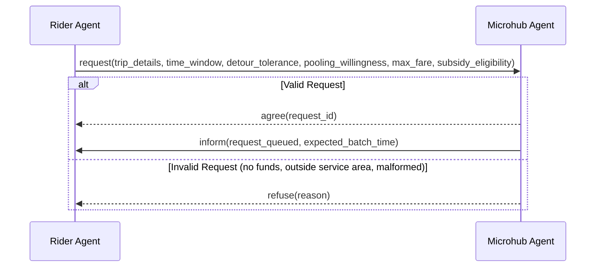
**Notes:**

- `agree` confirms the microhub will process the request; `inform(request_queued)` gives the rider a batching estimate.
    
- Invalid requests include insufficient funds, no valid subsidy, or origin outside hub coverage.

### 2.2. PoolFormationProtocol

**Initiator:** Microhub Agent  
**Responder:** Rider Agent  
**Purpose:** Microhub aggregates compatible riders and proposes a pool.
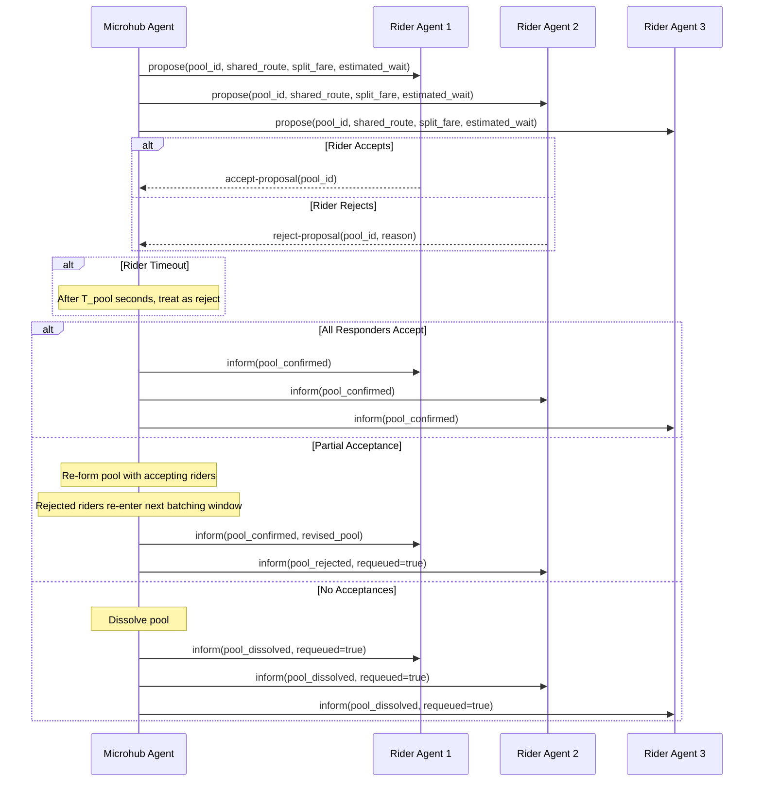
**Rules:**

- **Partial acceptance:** the microhub re-forms the pool with accepting riders only; rejecting riders are requeued.
    
- **Timeout:** any rider who does not respond within `T_pool` is treated as a rejection.
    
- **Minimum pool size:** if fewer than `min_pool_size` riders accept, the microhub may dissolve the pool and requeue all riders, or proceed with a solo trip (configurable per hub).
  

---

### 2.3. MatchAuctionProtocol (Core Protocol)

**Initiator:** Microhub Agent  
**Responder:** Driver Agent  
**Purpose:** Run a reverse auction to match a pool/trip with a driver.
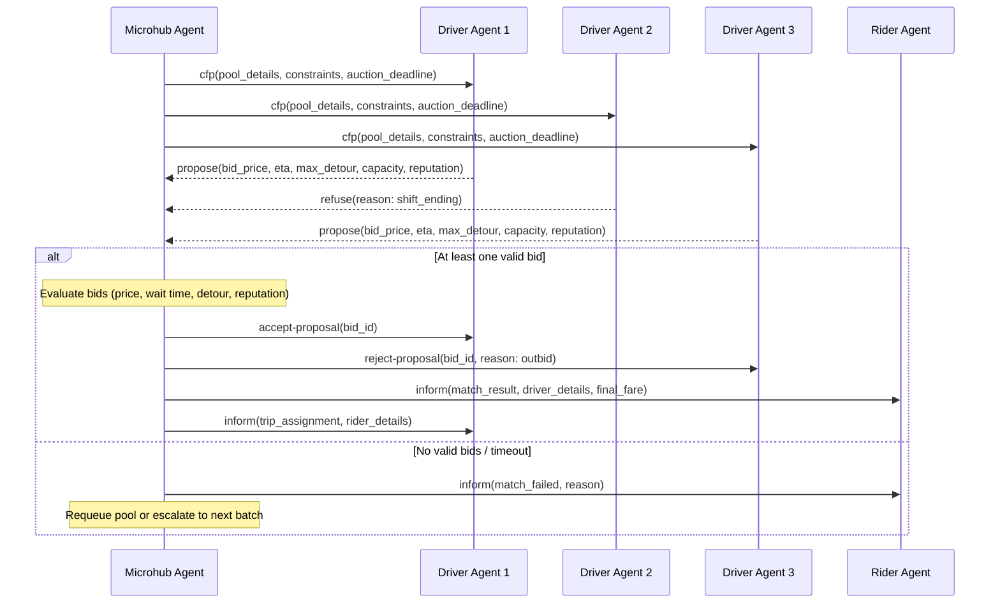
**Rules:**

- **Timeout:** bids must arrive before `auction_deadline`. Late bids are discarded.
    
- **No valid bids:** microhub informs riders of failure, requeues the pool, and may retry with widened constraints.
    
- **Winner notification:** all non-winning bidders receive `reject-proposal`.
    
- **Rider role:** the rider is _informed_ of the result, not an auction participant.
    

**Auction type options (per microhub):**

- First-price reverse auction (baseline).
    
- Second-price (Vickrey) reverse auction.
    
- Multi-attribute scoring with configurable weights.
    

---

## 3. Support and Logistics Protocols

### 3.1. DriverStatusProtocol

**Initiator:** Driver Agent  
**Responder:** Microhub Agent  
**Purpose:** Driver broadcasts location, capacity, and availability.
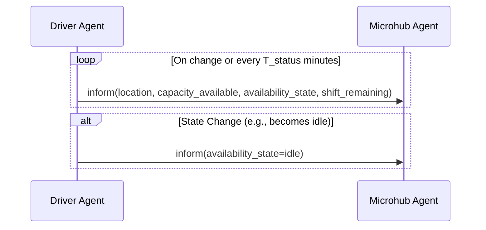
**Rules:**

- Drivers broadcast on state change (idle → assigned → busy → idle) and at least every `T_status` minutes.
    
- Microhubs use this to maintain a live driver registry for CFP targeting.
    

---

### 3.2. EscrowProtocol

**Initiator:** Rider Agent  
**Responder:** Payment Agent  
**Purpose:** Rider places fare in escrow before trip.
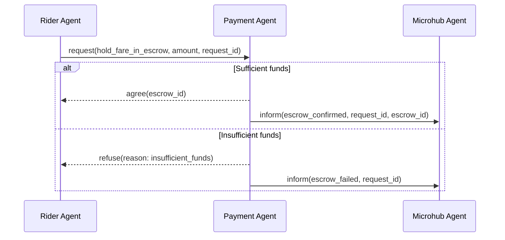

---

### 3.3. SettlementProtocol

**Initiator:** Microhub Agent  
**Responder:** Payment Agent  
**Purpose:** Post-trip payout and settlement.
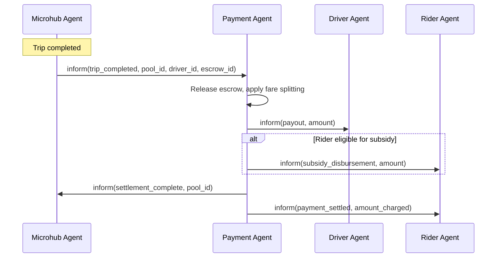
**Rules:**

- Payment is only released after `trip_completed` is confirmed by the microhub.
    
- Fare splitting follows the declared rule (proportional with pooling discount, Shapley, etc.).
    
- Subsidies are applied per regulator rules.
    

---

### 3.4. RefundProtocol

**Initiator:** Microhub Agent or Rider Agent  
**Responder:** Payment Agent  
**Purpose:** Process refunds for failed or cancelled trips.
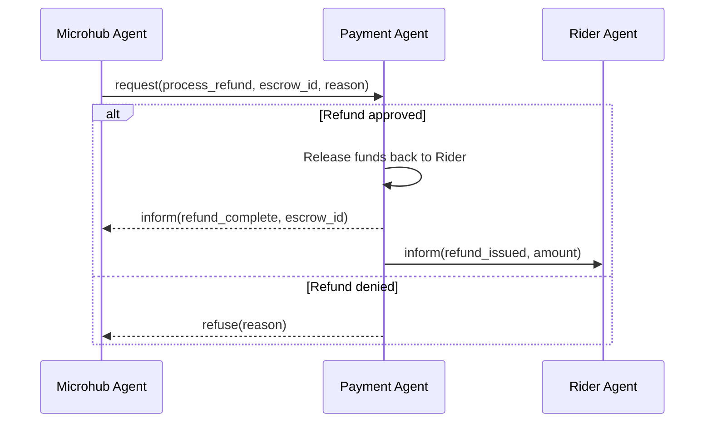
---

### 3.5. CancellationProtocol

**Initiator:** Rider Agent or Driver Agent  
**Responder:** Microhub Agent  
**Purpose:** Cancel a trip before or after assignment.
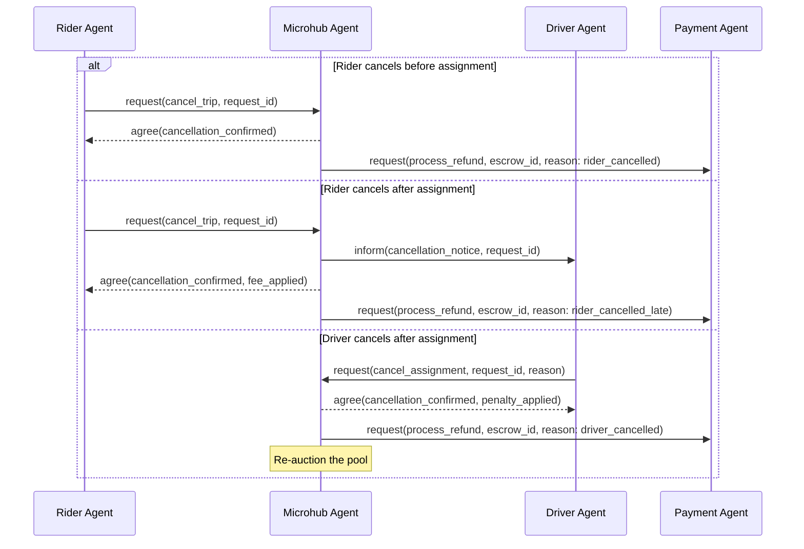
**Rules:**

- Cancellation before assignment: full refund.
    
- Cancellation after assignment (rider): partial refund, cancellation fee may apply.
    
- Cancellation by driver: full refund to rider; driver penalty applied via `ReputationProtocol`.
    

---

### 3.6. ReputationProtocol

**Initiator:** Rider Agent, Driver Agent, Microhub Agent, Reputation Agent  
**Responder:** Reputation Agent, Microhub Agent, Driver Agent  
**Purpose:** Collect ratings, answer reputation queries, and publish updated scores.
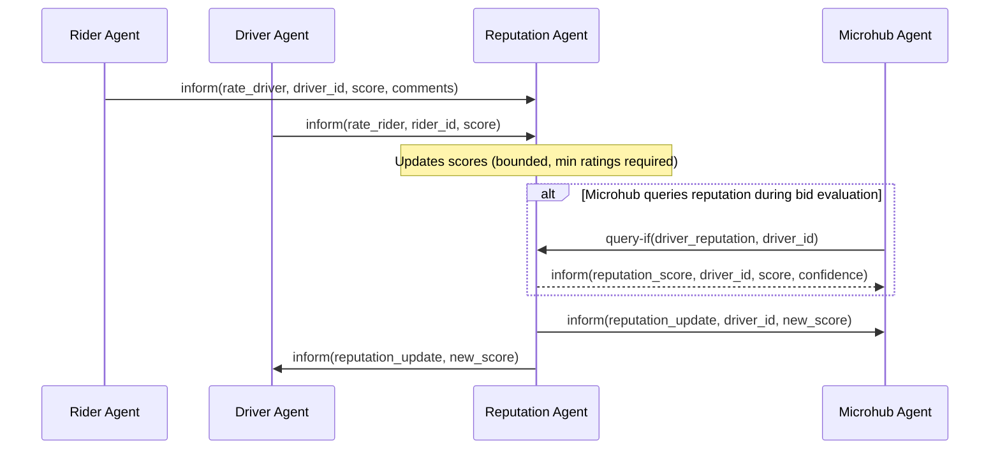
**Rules:**

- Self-rating is forbidden.
    
- Scores are bounded and require a minimum number of ratings before being published.
    
- Microhubs may query reputation during auction evaluation.
    

---

### 3.7. RepositionProtocol

**Initiator:** Microhub Agent  
**Responder:** Driver Agent  
**Purpose:** Incentivize drivers to reposition to staging points for future demand.
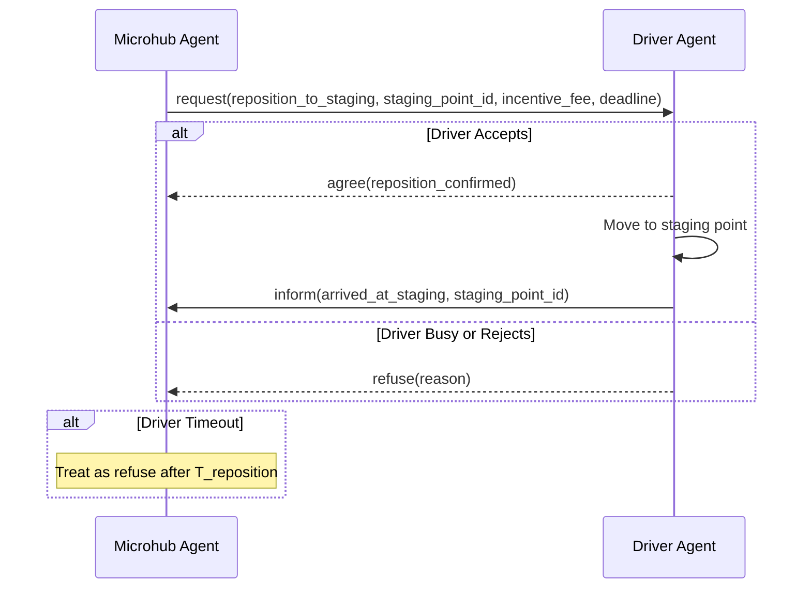

**Rules:**

- Repositioning is **optional** but incentivised (bonus, priority, fare guarantee).
    
- Drivers must not reposition while assigned to an active trip.
    
- If a driver does not respond within `T_reposition`, the microhub treats it as a refusal.
    
---

## 4. Environment and Regulation Protocols

### 4.1. TrafficUpdateProtocol

**Initiator:** Environment Agent  
**Responder:** Microhub Agent, Driver Agent  
**Purpose:** Broadcast traffic conditions and travel time estimates.
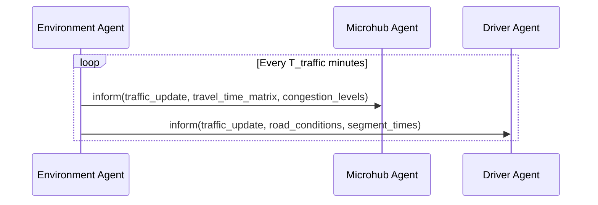

---

### 4.2. DisruptionProtocol

**Initiator:** Environment Agent  
**Responder:** Microhub Agent, Driver Agent  
**Purpose:** Broadcast disruptions (accidents, road closures, weather).
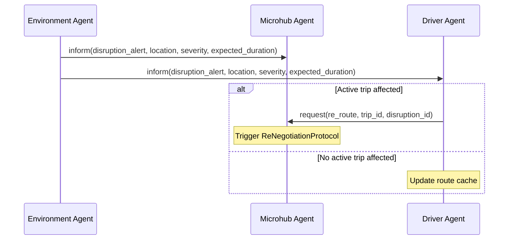

---

### 4.3. ReNegotiationProtocol

**Initiator:** Microhub Agent  
**Responder:** Driver Agent, Rider Agent  
**Purpose:** Re-negotiate trip parameters after a disruption or failure.
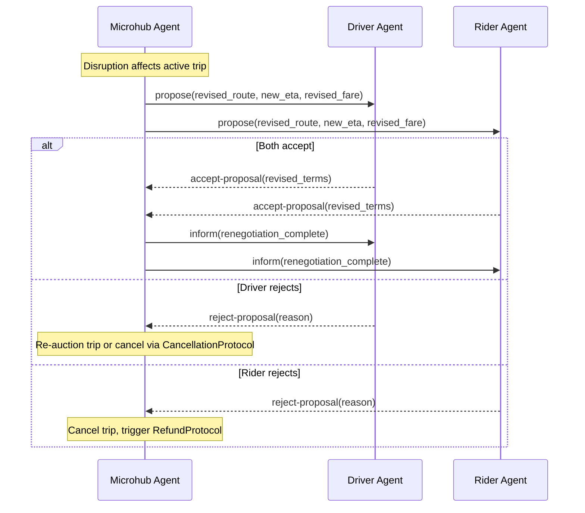

**Rules:**

- Re-negotiation is triggered by `DisruptionProtocol` or `DriverFailureProtocol`.
    
- If re-negotiation fails, the trip is cancelled and refunded.
    

---

### 4.4. DriverFailureProtocol

**Initiator:** Driver Agent  
**Responder:** Microhub Agent  
**Purpose:** Driver reports breakdown, accident, or inability to complete trip.
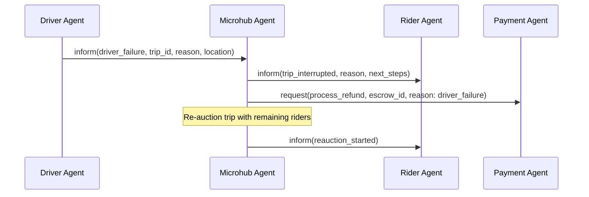

---

### 4.5. PolicyProtocol

**Initiator:** Regulator Agent  
**Responder:** Microhub Agent, Driver Agent  
**Purpose:** Broadcast fare caps, subsidies, and equity rules.
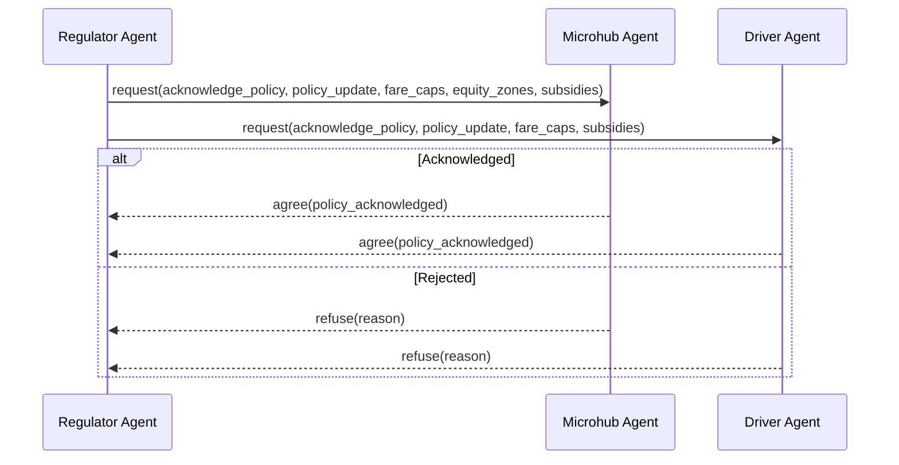

**Note:** `request` + `agree`/`refuse` is used instead of `inform` + `agree`, since `agree` is only valid as a response to a `request` or `propose` in FIPA-ACL.

---

### 4.6. AuditProtocol

**Initiator:** Regulator Agent  
**Responder:** Microhub Agent  
**Purpose:** Monitor microhub compliance with regulations.
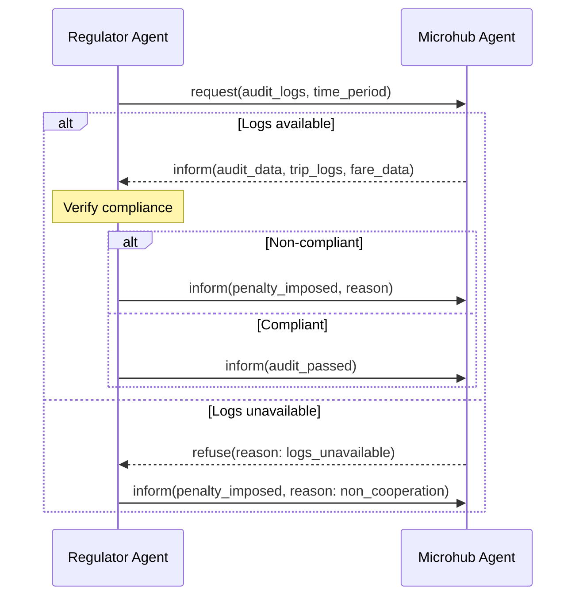

---

### 4.7. InterHubCoordinationProtocol

**Initiator:** Microhub Agent  
**Responder:** Neighbouring Microhub Agent  
**Purpose:** Exchange demand forecasts, coordinate overflow, and share driver state.
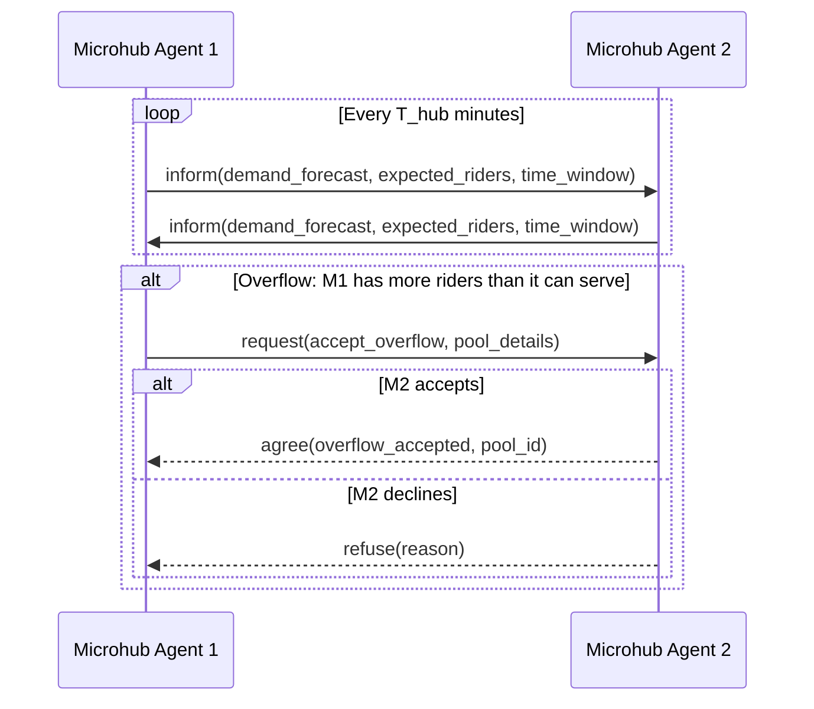

**Rules:**

- Hubs remain autonomous; coordination is voluntary.
    
- Overflow requests are best-effort, not obligations.
    
- Driver state sharing is optional and privacy-preserving (aggregate counts only).
    

---

## 5. Auxiliary Protocols

### 5.1. DemandForecastProtocol (Optional)

**Initiator:** Staging Point Agent (if active)  
**Responder:** Driver Agent, Microhub Agent  
**Purpose:** Broadcast local demand forecasts to nearby drivers and microhubs.
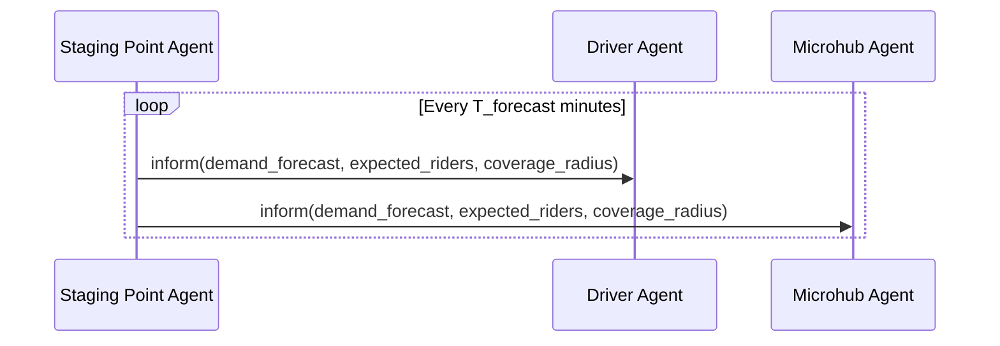

**Note:** If staging points are modelled as passive environmental objects, this protocol is folded into `TrafficUpdateProtocol` and issued by the Environment Agent.

---

### 5.2. TripExecutionProtocol

**Initiator:** Driver Agent  
**Responder:** Rider Agent  
**Purpose:** Manage the physical pickup and drop-off of pooled riders.
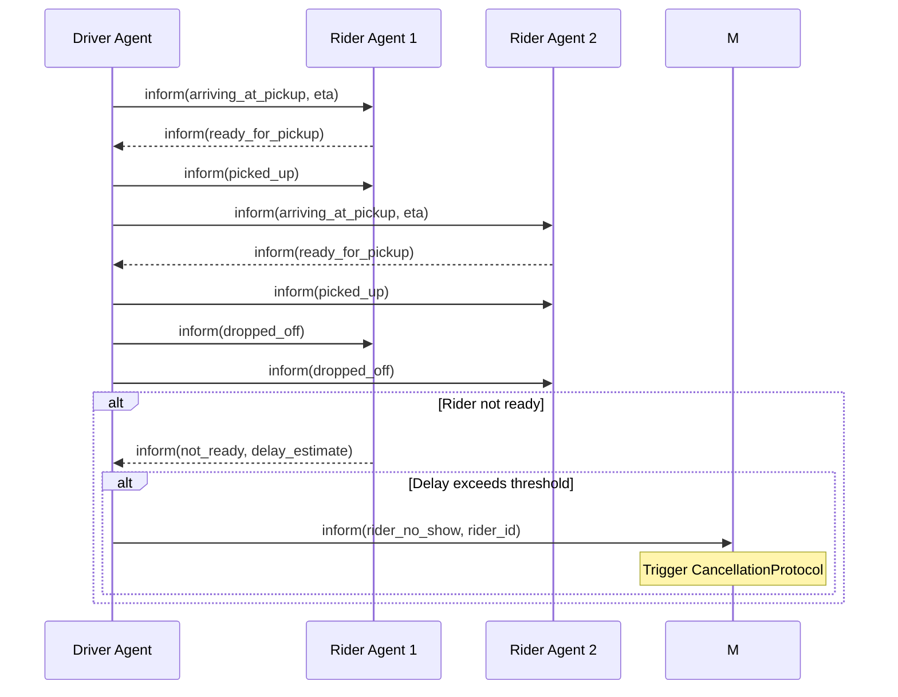

**Note:** `inform` is used instead of `agree` because `agree` is not a valid response to `inform` in FIPA-ACL.

---

## 6. Concurrency and Double-Booking Prevention

Because microhubs are independent and drivers may receive CFPs from multiple hubs simultaneously, the system must prevent double-booking.

### 6.1. Mechanism: Driver-Side Provisional Lock

A driver may hold **at most one provisional commitment** at a time.
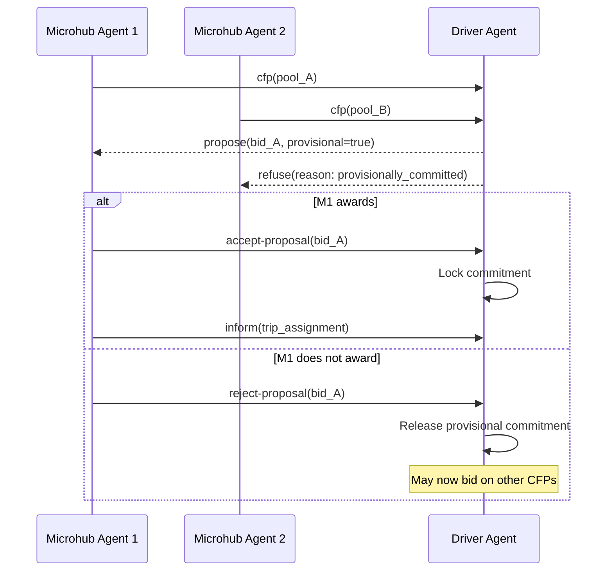

### 6.2. Rules

1. A driver may submit at most one `propose` with `provisional=true` at a time.
    
2. A provisional commitment expires after `T_provisional` if not confirmed.
    
3. On `accept-proposal`, the commitment becomes firm.
    
4. On `reject-proposal`, the commitment is released.
    
5. Microhubs must send `accept-proposal` or `reject-proposal` within `T_award`.
    

### 6.3. Alternative Mechanisms (for experimentation)

|Mechanism|Description|Trade-off|
|---|---|---|
|**Driver-side lock**|Driver holds one provisional bid.|Simple, may under-utilise drivers.|
|**Two-phase commit**|Microhub asks driver to hold, then confirms.|More message overhead.|
|**Optimistic**|Driver bids freely; refuses all but one on award.|Risk of broken commitments.|
|**Reputation penalty**|Driver penalised for breaking commitments.|Requires reputation system maturity.|

---

## 7. Interaction Summary Matrix

|Protocol|Initiator|Responder(s)|Key FIPA-ACL Performatives|
|---|---|---|---|
|`TripRequestProtocol`|Rider|Microhub|`request`, `agree`, `refuse`, `inform`|
|`PoolFormationProtocol`|Microhub|Rider|`propose`, `accept-proposal`, `reject-proposal`, `inform`|
|`MatchAuctionProtocol`|Microhub|Driver|`cfp`, `propose`, `refuse`, `accept-proposal`, `reject-proposal`, `inform`|
|`DriverStatusProtocol`|Driver|Microhub|`inform`|
|`EscrowProtocol`|Rider|Payment|`request`, `agree`, `refuse`, `inform`|
|`SettlementProtocol`|Microhub|Payment|`inform`|
|`RefundProtocol`|Microhub / Rider|Payment|`request`, `agree`, `refuse`, `inform`|
|`CancellationProtocol`|Rider / Driver|Microhub|`request`, `agree`, `refuse`, `inform`|
|`ReputationProtocol`|Rider / Driver / Microhub|Reputation|`inform`, `query-if`|
|`RepositionProtocol`|Microhub|Driver|`request`, `agree`, `refuse`, `inform`|
|`TrafficUpdateProtocol`|Environment|All|`inform`|
|`DisruptionProtocol`|Environment|All|`inform`|
|`ReNegotiationProtocol`|Microhub|Driver, Rider|`propose`, `accept-proposal`, `reject-proposal`, `inform`|
|`DriverFailureProtocol`|Driver|Microhub|`inform`|
|`PolicyProtocol`|Regulator|Microhub, Driver|`request`, `agree`, `refuse`|
|`AuditProtocol`|Regulator|Microhub|`request`, `inform`, `refuse`|
|`InterHubCoordinationProtocol`|Microhub|Microhub|`inform`, `request`, `agree`, `refuse`|
|`DemandForecastProtocol` (optional)|Staging Point|Driver, Microhub|`inform`|
|`TripExecutionProtocol`|Driver|Rider|`inform`|

---

## 8. Mapping to SPADE FSMBehaviour

When moving to the coding phase, these protocols will be implemented as **FSMBehaviour** (Finite State Machine Behaviour) inside SPADE agents.

### 8.1. `MicrohubAgent` — MatchAuctionProtocol FSM

1. **State 1 (Start):** Send `cfp` to all known Driver Agents.
    
2. **State 2 (Collecting Bids):** Wait for `propose` or `refuse`. Set timeout `T_auction`.
    
3. **State 3 (Evaluating):** Evaluate bids with multi-attribute function (price, wait time, detour, reputation).
    
4. **State 4 (Awarding):** Send `accept-proposal` to winner, `reject-proposal` to losers.
    
5. **State 5 (Informing):** Send `inform` to Rider Agents with match result.
    
6. **State 6 (Failure):** If no valid bids, inform riders and requeue pool.
    
7. **State 7 (End):** Reset FSM for next auction.
    

### 8.2. `DriverAgent` — MatchAuctionProtocol FSM

1. **State 1 (Idle):** Wait for `cfp`.
    
2. **State 2 (Evaluating):** Check shift, capacity, reserve price, overlap.
    
3. **State 3 (Bidding):** Send `propose` with `provisional=true` if eligible; otherwise `refuse`.
    
4. **State 4 (Awaiting Award):** Wait for `accept-proposal` or `reject-proposal` until `T_award`.
    
5. **State 5 (Committed):** Lock commitment, await `trip_assignment`.
    
6. **State 6 (Released):** On `reject-proposal` or timeout, release commitment and return to Idle.
    

### 8.3. `RiderAgent` — TripRequestProtocol FSM

1. **State 1 (Idle):** User initiates request.
    
2. **State 2 (Requesting):** Send `request` to microhub.
    
3. **State 3 (Awaiting Pool):** Wait for `propose(pool)`.
    
4. **State 4 (Deciding):** Evaluate pool proposal; send `accept-proposal` or `reject-proposal`.
    
5. **State 5 (Awaiting Match):** Wait for `inform(match_result)`.
    
6. **State 6 (InTrip):** Interact via `TripExecutionProtocol`.
    
7. **State 7 (Rating):** Send rating via `ReputationProtocol`.
    
8. **State 8 (End):** Return to Idle.
    

### 8.4. `PaymentAgent` — EscrowProtocol + SettlementProtocol FSM

1. **State 1 (Idle):** Wait for `request(hold_fare_in_escrow)`.
    
2. **State 2 (Escrow Held):** Confirm with `agree(escrow_id)`, notify microhub.
    
3. **State 3 (Awaiting Completion):** Wait for `inform(trip_completed)`.
    
4. **State 4 (Settling):** Release escrow, split fare, pay driver, disburse subsidy.
    
5. **State 5 (Settled):** Notify all parties; return to Idle.
    
6. **State 6 (Refunding):** On `request(process_refund)`, release funds to rider.
    

---

## 9. Theme Coverage Checklist

|Theme Element|Where Covered|
|---|---|
|Time windows|Rider (input), Microhub (constraint), Driver (bid feasibility)|
|Detour tolerance|Rider (input), Microhub (pool feasibility), Driver (bid constraint)|
|Driver shifts|Driver (safety), Microhub (assignment constraint)|
|Traffic variability|`TrafficUpdateProtocol`, `DisruptionProtocol`, `ReNegotiationProtocol`|
|Pooling|`PoolFormationProtocol`, Rider (willingness), Driver (capacity)|
|Pricing schemes|Driver (reserve/bid), Microhub (rule), `EscrowProtocol`, `SettlementProtocol`|
|Equity/fairness|Regulator (`PolicyProtocol`), Microhub (constraints), metrics|
|Repositioning|`RepositionProtocol`, `DriverStatusProtocol`, Staging Point (coverage)|
|Decentralisation|Independent Microhub agents, `InterHubCoordinationProtocol`, driver autonomy|
|Auction mechanism|`MatchAuctionProtocol`, multi-attribute evaluation|
|Concurrency|Section 6: Driver-side provisional lock|
|Failure handling|Timeouts, `CancellationProtocol`, `DriverFailureProtocol`, `RefundProtocol`|
|Reputation|`ReputationProtocol` with query support|

---

## 10. Open Design Questions

1. **Auction type:** First-price, second-price, or VCG? Multi-attribute or price-only?
    
2. **Fare splitting:** Equal, proportional to solo fare, proportional to distance, or Shapley?
    
3. **Pooling batching window:** How long does a microhub wait before forming a pool?
    
4. **Staging points:** Active agents or passive environmental objects?
    
5. **Inter-hub coordination:** How much should hubs share? Fully independent or federated?
    
6. **Reputation:** Global or per-microhub? How is tampering prevented?
    
7. **Subsidy mechanism:** Direct to rider, to microhub, or to driver?
    
8. **Concurrency mechanism:** Driver-side lock, two-phase commit, or optimistic?
    
9. **Re-negotiation policy:** Who has final say — microhub, driver, or rider?
    
10. **Penalty design:** How are driver cancellations, rider no-shows, and broken commitments penalised?
    

---

## 11. Revision Summary (Changes from Preliminary Version)

|Change|Rationale|
|---|---|
|Added `alt`/`else` blocks for failures and timeouts|Preliminary model showed only happy paths.|
|Handled partial acceptance in `PoolFormationProtocol`|Pool behaviour was undefined when some riders rejected.|
|Removed Rider from `MatchAuctionProtocol` responders|Rider is informed, not an auction participant.|
|Split `PaymentProtocol` into `EscrowProtocol` + `SettlementProtocol`|Cleaner FSM implementation, clearer responsibilities.|
|Added `InterHubCoordinationProtocol`|Role model mentioned inter-hub demand exchange; protocol was missing.|
|Added `ReNegotiationProtocol`|Disruption handling was incomplete.|
|Added `DriverFailureProtocol`|Mid-trip failure was unhandled.|
|Added `CancellationProtocol`|Rider/driver cancellation was unhandled.|
|Added `DriverStatusProtocol`|Role model required location/capacity updates; protocol was missing.|
|Fixed `PolicyProtocol` to use `request` + `agree`/`refuse`|`agree` is invalid as a response to `inform`.|
|Fixed `TripExecutionProtocol` to use `inform` instead of `agree`|Same reason.|
|Added `query-if` sub-protocol to `ReputationProtocol`|Microhubs need reputation during bid evaluation.|
|Marked `DemandForecastProtocol` as optional|Staging Point Agent is optional.|
|Added Section 6: Concurrency and Double-Booking Prevention|Critical for decentralised auctions.|
|Added FSM mappings for Driver, Rider, and Payment agents|Preliminary only had Microhub FSM.|
|Expanded theme coverage checklist|Now includes concurrency, failure handling, reputation.|